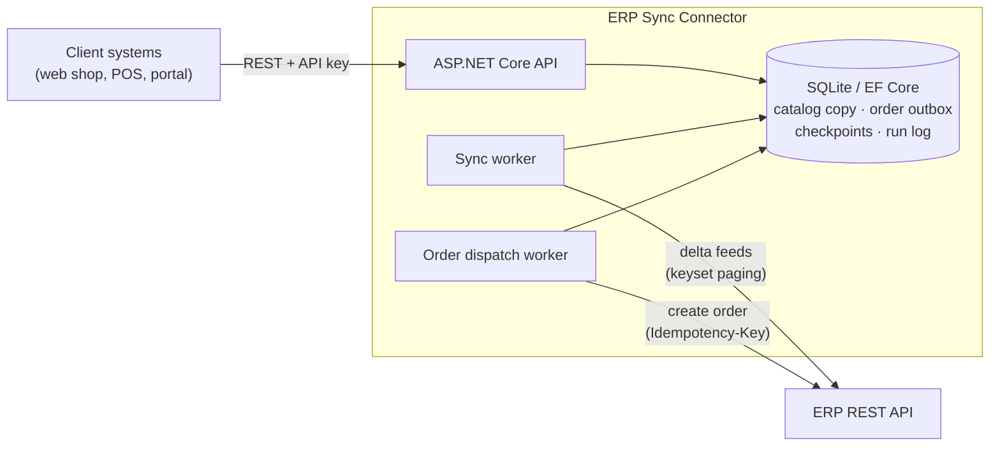
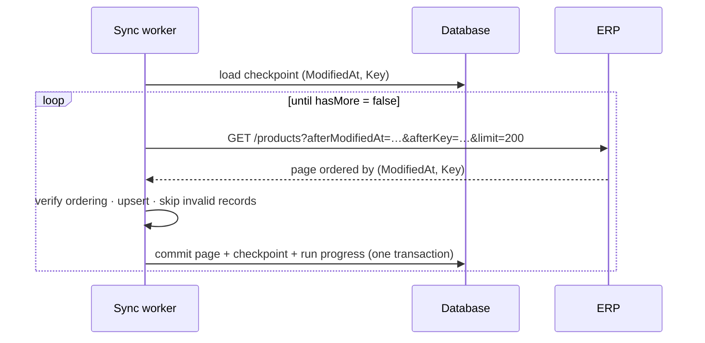
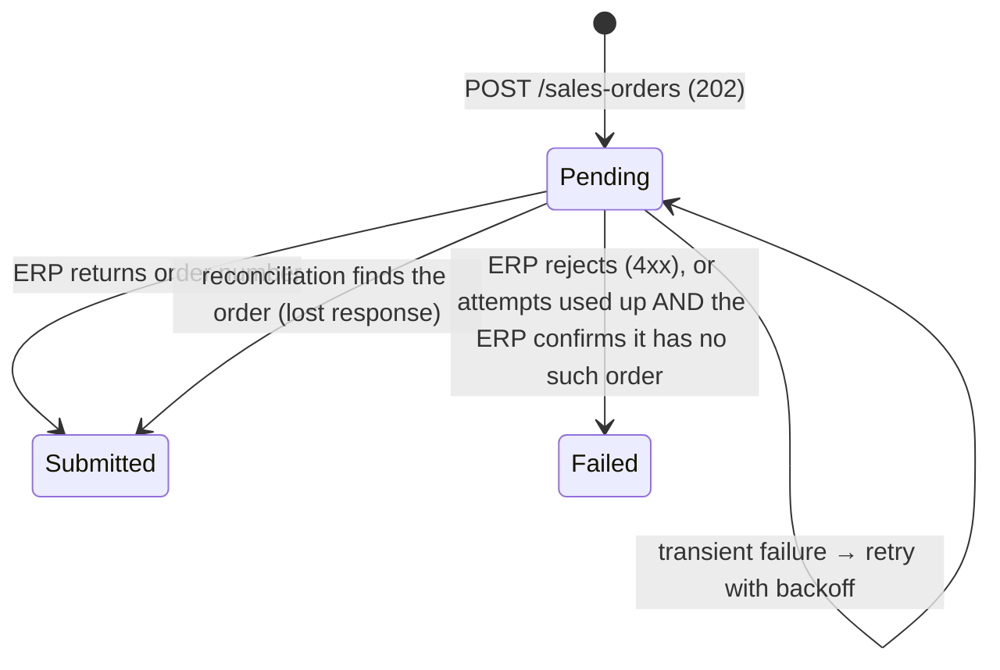

# ERP Sync Connector

[](https://github.com/ucciefmhmd/erp-sync-connector/actions/workflows/ci.yml)


A **.NET 10 integration service** that keeps a local copy of ERP master data (products, stock and customers) in sync, and delivers sales orders back to the ERP **without duplicates**, even when the ERP is slow, failing, or loses responses.

It is the kind of connector that sits between an e‑commerce site, POS or portal and an ERP. I built it as a reference implementation of the patterns I use for system integrations. The ERP side is a **mock ERP** with a generic REST contract (included), so you can run the whole thing locally.



## What it demonstrates

| Area | How |
|---|---|
| **Clean Architecture** | `Domain` → `Application` → `Infrastructure` → `Api`. The domain has no dependencies; the ERP and the database are ports implemented in Infrastructure. |
| **Incremental sync** | Keyset paging over `(ModifiedAt, Key)` change feeds, a per-entity checkpoint committed **in the same transaction** as each page, resume-from-checkpoint after failures, and an optional overlap window for feeds whose timestamps can arrive late. |
| **Reliable order delivery** | Transactional outbox; an idempotent `POST` (Idempotency-Key per client, plus a payload fingerprint); a claim with a lease and an optimistic-concurrency token; exponential backoff with jitter; and **reconciliation** before any retry after an ambiguous failure. An order the ERP *might* have is never failed or resent without checking first. |
| **Resilience** | `Microsoft.Extensions.Http.Resilience`: retries with jitter for safe calls only, per-attempt and total timeouts, a circuit breaker, and token refresh on 401. |
| **Error handling** | A `Result` type for expected business errors, RFC 9457 ProblemDetails everywhere, poison records skipped instead of blocking the feed, and failures classified as *rejected* vs *unavailable* vs *outcome unknown*. |
| **API security** | Scoped API keys (stored as SHA‑256 hashes, compared in constant time, validated at startup); orders isolated per client (another client's order id is a 404); rate limiting per client, and per IP for unauthenticated calls; a 256 KB request limit; security headers; no server banner; and no exception details in responses. |
| **Background processing** | Hosted services: a scheduler with on-demand triggers (`Channel<T>`), and an outbox dispatcher that wakes on new orders and sleeps until the next retry is due. |
| **Observability** | Structured logging (Serilog, source-generated `LoggerMessage`), trace ids on every request, sync run and order delivery (propagated to the ERP via W3C `traceparent`), metrics via `System.Diagnostics.Metrics`, and liveness/readiness health checks. |
| **Quality** | 47 tests (domain, component tests on real SQLite, and HTTP integration tests), analyzers at `latest-recommended` with warnings as errors, central package management, CI with a vulnerable-package check, Docker images, and Dependabot. |

## Quick start

**Option A: Docker** (no .NET SDK needed)

```bash
docker compose up --build
```

**Option B: .NET 10 SDK**

```bash
# terminal 1: the mock ERP on http://localhost:5080
dotnet run --project tools/ErpSync.MockErp

# terminal 2: the connector on http://localhost:5100
dotnet run --project src/ErpSync.Api
```

The interactive API reference is at **http://localhost:5100/scalar/v1**. Use the development key `dev-local-key-change-me`. It's a demo value that only exists in `appsettings.Development.json` and `docker-compose.yml`.

```bash
KEY=dev-local-key-change-me

# Products synced from the ERP (the first sync runs at startup)
curl -H "X-Api-Key: $KEY" "http://localhost:5100/api/v1/products?pageSize=5"

# A product with stock per warehouse
curl -H "X-Api-Key: $KEY" http://localhost:5100/api/v1/products/SKU-00001

# Place an order: 202 Accepted plus a Location to poll
curl -i -X POST http://localhost:5100/api/v1/sales-orders \
  -H "X-Api-Key: $KEY" -H "Content-Type: application/json" \
  -H "Idempotency-Key: $(uuidgen)" \
  -d '{"customerCode":"C0001","customerReference":"PO-1001","lines":[{"sku":"SKU-00001","quantity":2}]}'

# Sync history and checkpoints
curl -H "X-Api-Key: $KEY" http://localhost:5100/api/v1/sync/runs
```

The mock ERP misbehaves on purpose. About 5% of calls return 503, latency is random, and **10% of orders are saved but answered with HTTP 500**. Watch the connector's logs: it retries, and it reconciles the lost responses instead of sending those orders twice. One seeded product (`BROKEN-0001`) has an empty name, so you can see a poison record being skipped.

## How it works

### Incremental sync



* **Keyset, not offset paging.** A record that changes during a run moves to the *end* of the feed instead of shifting other records past the cursor.
* **Overlap window.** Keyset paging assumes a change never becomes visible with a timestamp *earlier* than records already read. Real ERPs can break that assumption (long transactions, clock skew). Each run therefore re-reads `Sync:FeedOverlap` (2 minutes by default) before the checkpoint. Set it to zero for feeds you trust.
* **Idempotent upserts.** An update older than (or equal to) the stored version is ignored, so re-reading a page after a crash or inside the overlap window is harmless.
* **The feed contract is checked.** If the ERP ever returns records out of order, the run fails loudly instead of silently corrupting the checkpoint.
* **Poison records** (for example a product with no name) are logged, counted in `SyncRun.RecordsSkipped` and skipped, so one bad row can't stall the feed. A skipped record is picked up again the next time the ERP changes it.
* **Flat memory.** Tracked entities are cleared after every committed page, so a first full sync of a large catalog doesn't grow the EF Core change tracker.

### Order delivery



1. **Accept.** The API validates the order (FluentValidation, then the synced catalog: unknown or blocked customers and products are refused with 422). It stores the order in the outbox and returns `202 Accepted`. Idempotency keys are scoped to the calling client: the same key with the same payload returns the original order, and the same key with a different payload returns `409`.
2. **Claim.** The dispatcher increments `Attempts` (an EF Core concurrency token) and sets a lease (`Orders:AttemptLease`, which must exceed one delivery's worst-case duration). If two instances race, only one save succeeds.
3. **Reconcile, if needed.** If the previous attempt *might* have reached the ERP (a timeout, a 5xx, a 409, or a crash mid-call), the dispatcher first asks the ERP for the order by its external reference.
4. **Send.** The `Idempotency-Key` header lets the ERP de-duplicate as well. A rejection fails the order. A transient error schedules a retry with exponential backoff and ±20% jitter. When `MaxAttempts` is used up, the order fails only if the outcome is known. Otherwise one more reconcile-only attempt runs first, because failing an order the ERP might have invites a duplicate later.

HTTP-level retries are **disabled for POST** on purpose. Blindly retrying a non-idempotent call is how duplicate orders happen, so the outbox does it safely instead.

**Guarantee, stated precisely:** the connector never sends an order again without first confirming the ERP doesn't have it. Duplicates are only possible if the ERP neither honours `Idempotency-Key` nor makes a just-created order visible to the lookup.

## API

| Method | Path | Scope | |
|---|---|---|---|
| GET | `/api/v1/products` | `catalog:read` | Paged and filterable (`isActive`, `modifiedSince`, `search`) |
| GET | `/api/v1/products/{sku}` | `catalog:read` | Includes stock per warehouse |
| GET | `/api/v1/customers/{code}` | `catalog:read` | Open balance |
| POST | `/api/v1/sales-orders` | `orders:write` | Needs an `Idempotency-Key` header → `202` |
| GET | `/api/v1/sales-orders/{id}` | `orders:write` | Delivery status and ERP order number (own orders only) |
| POST | `/api/v1/sync/{entity}/run` | `sync:admin` | Triggers a sync now (`products`, `stock`, `customers`) |
| GET | `/api/v1/sync/runs` | `sync:admin` | Run history with counts, errors and trace ids |
| GET | `/api/v1/sync/checkpoints` | `sync:admin` | How far each feed has been read |
| GET | `/health/live`, `/health/ready` | public | Readiness reports *Degraded* (not down) when the ERP is unreachable |

Every error is an `application/problem+json` response with a `traceId`. Business errors also carry a machine-readable `code` and per-field `errors`.

## Project structure

```
src/
  ErpSync.Domain           Entities and invariants: Product, StockLevel, Customer, SalesOrder (state machine),
                           SyncCheckpoint, SyncRun, SyncPosition. No dependencies.
  ErpSync.Application      Use cases and ports: sync engine, order outbox (create, dispatch), IErpClient,
                           repositories, Result/AppError, telemetry.
  ErpSync.Infrastructure   EF Core (SQLite) persistence and migrations, ERP HTTP adapter (token auth,
                           resilience, error classification), health checks.
  ErpSync.Api              Minimal API endpoints, API-key auth, rate limiting, ProblemDetails, background workers.
tools/
  ErpSync.MockErp          Fake ERP with token auth, keyset feeds and fault injection.
tests/
  ErpSync.UnitTests        Domain rules, plus component tests of the sync and outbox on real SQLite.
  ErpSync.IntegrationTests The whole HTTP pipeline via WebApplicationFactory.
```

## Configuration

Settings come from `appsettings.json`, environment variables (`Erp__ClientSecret`, …) or user secrets.

| Section | Key settings |
|---|---|
| `ConnectionStrings` | `ErpSync` (SQLite connection string) |
| `Erp` | `BaseUrl`, `ClientId`, `ClientSecret`, `AttemptTimeout`, `TotalTimeout`, `MaxRetryAttempts` |
| `Sync` | `PageSize`, `MaxPagesPerRun`, `FeedOverlap`, `ProductsInterval`, `StockInterval`, `CustomersInterval` |
| `Orders` | `MaxAttempts`, `BaseRetryDelay`, `MaxRetryDelay`, `AttemptLease`, `DispatchBatchSize`, `DispatchPollInterval`, `ValidateAgainstCatalog` |
| `Authentication:ApiClients` | `Name`, `KeyHash` (SHA-256 hex), `Scopes` (`catalog:read`, `orders:write`, `sync:admin`) |
| `RateLimiting` | `PermitPerMinute` per client (per IP when unauthenticated) |
| `Workers` | `Enabled`: turn background processing off, for example for a read-only replica |
| `Database` | `MigrateOnStartup` |
| `OpenApi` | `Enabled` (defaults to on in Development only) |

Options and API clients are validated at startup. A missing ERP URL, a malformed key hash or a misspelled scope stops the app instead of failing on the first request.

**Adding an API client.** Generate a random key, give it to the client, and store only its hash:

```bash
KEY=$(openssl rand -base64 32)
echo -n "$KEY" | sha256sum | cut -d' ' -f1   # → KeyHash
```

## Testing

```bash
dotnet test
```

* **Domain tests:** invariants such as out-of-order updates, checkpoints that can't move backwards, and the order state machine.
* **Component tests:** the real services and EF Core mappings on in-memory SQLite, with a fake ERP and a `FakeTimeProvider`. They cover:
  * resume after a mid-run failure, and the overlap window catching a late change
  * poison records, and feed-contract violations
  * retry and backoff
  * reconciliation after a lost response (asserting the ERP received exactly one create call), and reconcile-before-fail on the last attempt
  * the concurrency token rejecting a second claim
* **Integration tests:** the full API over HTTP, covering 401 and 403 by scope, isolation of orders between clients, 429 rate limiting (including unauthenticated callers), 400/409/422 problem responses, security headers, and an order going from `202` to `submitted`.

## Production notes

This is a reference project. For a real deployment I would change the following:

* **Database:** SQL Server or PostgreSQL instead of SQLite (only the EF provider changes), with migrations run from the release pipeline rather than at startup.
* **Identity:** OAuth 2.0 client credentials (for example Microsoft Entra ID) instead of static API keys, with secrets in Azure Key Vault.
* **Telemetry:** wire the existing `ActivitySource` and `Meter` to OpenTelemetry (Azure Monitor, Grafana, …).
* **Scale-out:** the outbox claim is already safe across instances. Scheduled sync would also need a distributed lock (or a single worker instance).
* **Operations:** an endpoint to retry `Failed` orders after the cause is fixed. It would reconcile first, like the dispatcher does.
* **Reverse proxy:** enable forwarded-headers handling with the proxy's address configured, so per-IP rate limiting sees real client IPs.

## License

[MIT](LICENSE)
