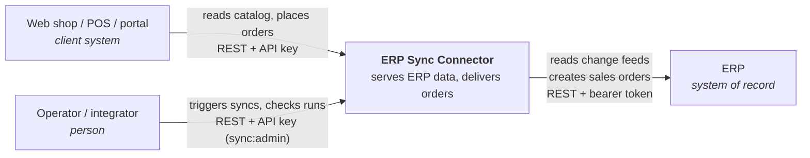
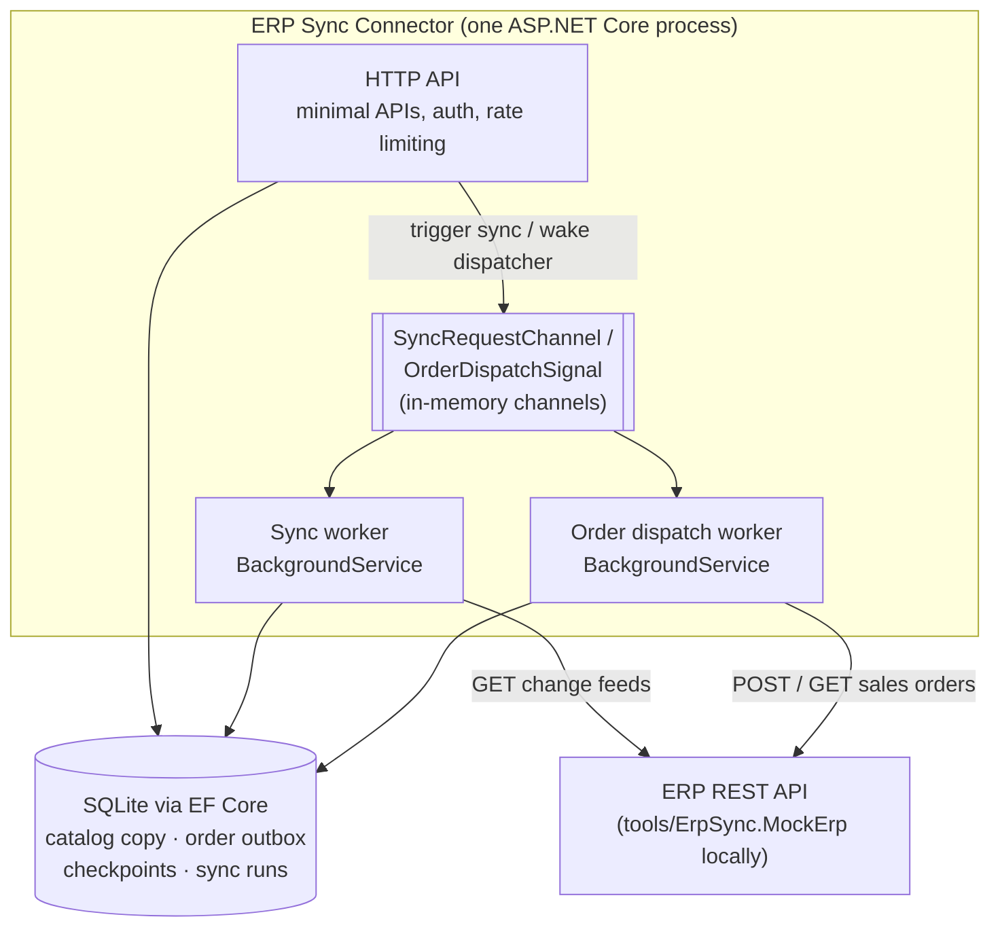
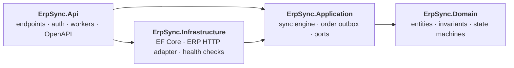
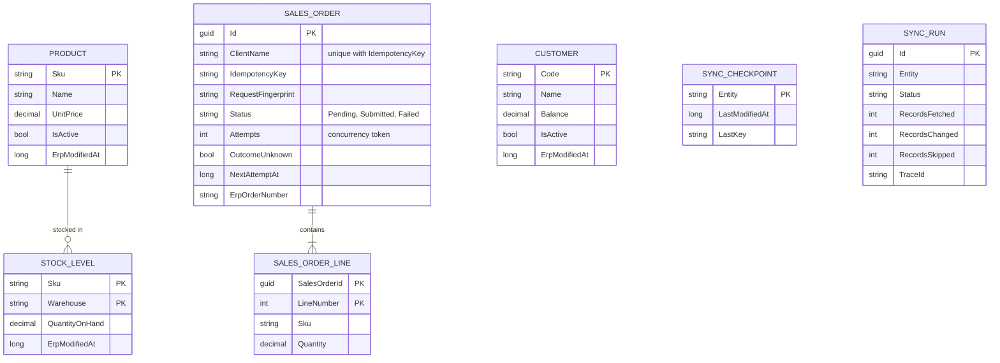
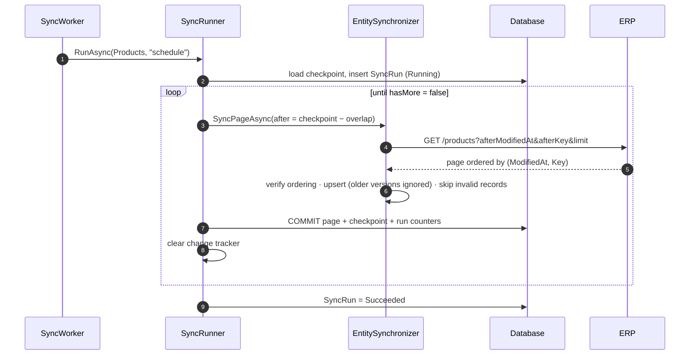
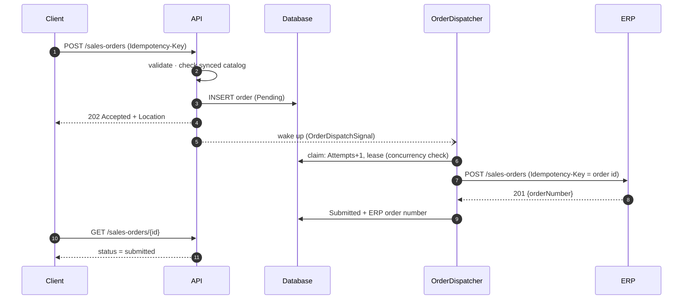
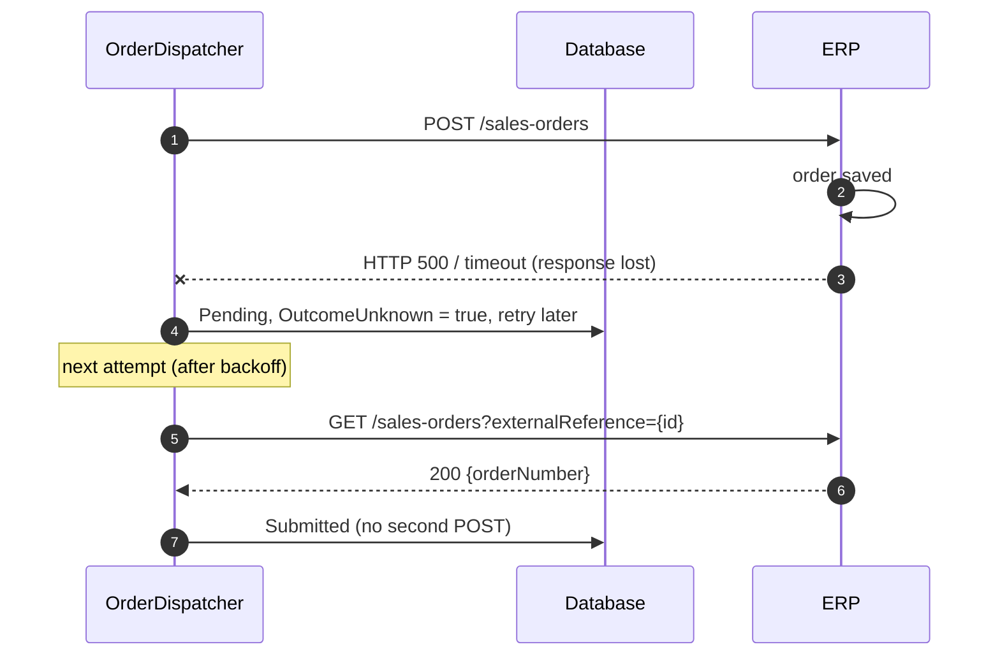
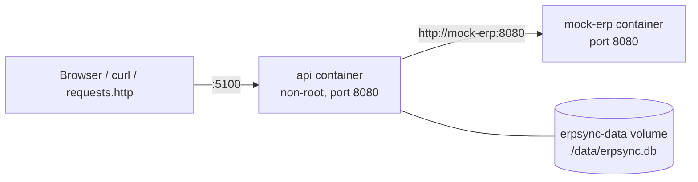

# Architecture

This document describes the ERP Sync Connector from the outside in: how it fits into a landscape, what runs where, how the code is layered, and how the two main flows (sync and order delivery) work step by step. For *why* things are built this way, see the [design patterns guide](design-patterns.md) and the [architecture decision records](adr/).

## 1. System context

The ERP stays the **system of record**. The connector keeps a read copy of the data clients need often (products, stock, customers), so client traffic never hits the ERP directly. It also accepts orders even when the ERP is down, delivering them once the ERP is back.

## 2. Containers

* **One deployable.** The API and both workers share a process and a database. The workers can be switched off (`Workers:Enabled=false`), for example in tests or on extra API-only instances.
* **The channels are signals, not storage.** Everything that must survive a restart lives in the database. Losing an in-memory signal only delays work until the next poll.

## 3. Code structure (Clean Architecture)

Dependencies point inwards. `Domain` has no package references. `Application` defines the **ports** it needs (`IErpClient`, the repositories, `IUnitOfWork`, `IReadModelQueries`), and `Infrastructure` implements them. Nothing in `Application` knows about HTTP, EF Core or SQLite.

| Layer | Key types |
|---|---|
| Domain | `Product`, `StockLevel`, `Customer`, `SalesOrder` (delivery state machine), `SyncCheckpoint`, `SyncRun`, `SyncPosition` |
| Application | `SyncRunner`, `EntitySynchronizer<T>` and its three implementations, `CreateSalesOrderHandler`, `OrderDispatcher`, `RetryBackoff`, `Result<T>` / `AppError` |
| Infrastructure | `ErpSyncDbContext` (also the unit of work), repositories, `ReadModelQueries`, `ErpApiClient`, `ErpTokenProvider`, `ErpAuthenticationHandler`, `ErpHealthCheck` |
| Api | `CatalogEndpoints`, `OrderEndpoints`, `SyncEndpoints`, `ApiKeyAuthenticationHandler`, `SyncWorker`, `OrderDispatchWorker`, OpenAPI transformers |

## 4. Data model

Timestamps are stored as UTC ticks (`long`), because SQLite can't compare or sort `DateTimeOffset` values natively.

## 5. Flow: incremental sync

If any step fails, the uncommitted changes are discarded, the run is marked `Failed` with its error and trace id, and the next run resumes from the last committed checkpoint.

## 6. Flow: order delivery

**Happy path**

**Lost response, reconciled instead of resent**

## 7. Deployment (local demo)

`docker compose up --build` runs this setup. The same images build in CI on every push.

## 8. Known gaps

* The two `BackgroundService` loops (`SyncWorker`, `OrderDispatchWorker`) are thin schedulers. The logic they call is covered by tests, but the loops themselves are only exercised by running the app.
* The scheduled sync assumes **one worker instance**. The order outbox is already safe with several instances; the sync scheduler would need a distributed lock. See [ADR 0004](adr/0004-sqlite-and-ef-core-for-the-reference-implementation.md).
